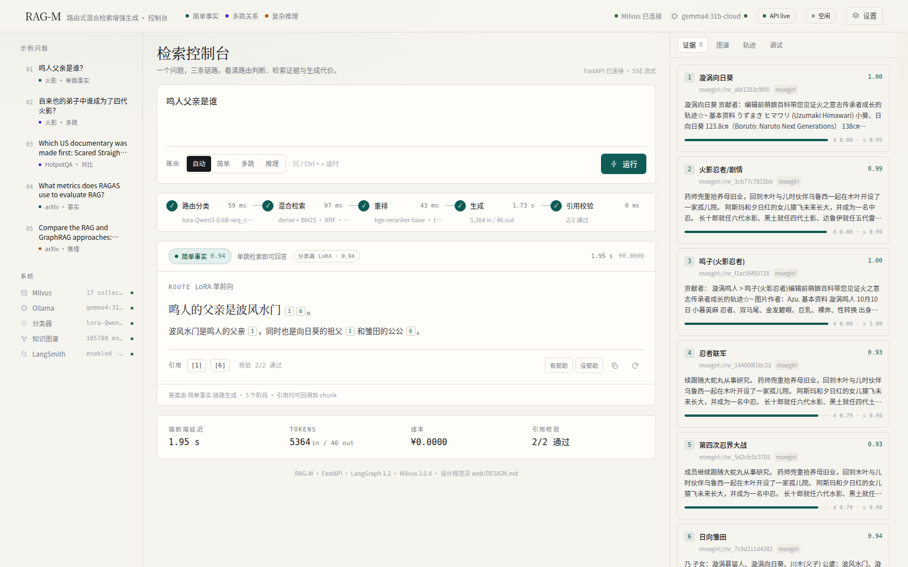
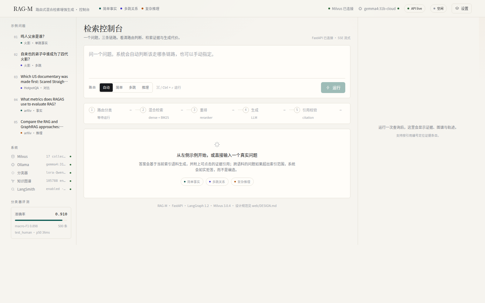
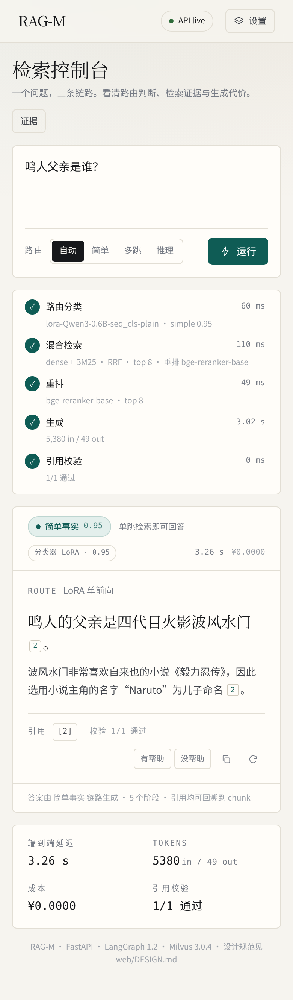

# RAG-M：路由式混合 RAG 问答系统

一个面向学习与实验的 RAG 系统：先判断问题类型，再走三条不同的检索/推理链路——
**简单事实 → 混合检索 RAG**，**多跳关系 → Graph RAG**，**复杂推理 → Agentic RAG（按需调用工具）**。

- 技术栈：LangGraph 1.2 · Milvus 3.0 · Neo4j 5 · FastAPI · React 19 · Docker · Ollama（或任意 OpenAI 兼容 LLM）
- 分类器：Qwen3-0.6B + SEQ_CLS LoRA（500 条人工裁决测试集 macro-F1 0.898）
- 检索：embeddinggemma-300m + Milvus 3.0 BM25 混合检索 + bge-reranker-base 重排
- 已实测语料：HotpotQA / CMRC 演示语料、萌娘百科火影忍者 220 篇、arXiv RAG 论文 8 篇（可用 `make use-all` 合并为一个索引一次检索）

---

## 一、系统架构

```
                        ┌─────────────────────────────┐
  用户问题 ───────────▶ │  Query Classifier (LoRA 0.6B) │
                        └──────────────┬──────────────┘
                                       │ simple / multihop / reasoning
              ┌────────────────────────┼────────────────────────┐
              ▼                        ▼                        ▼
      ┌───────────────┐        ┌───────────────┐        ┌──────────────────┐
      │ Simple RAG    │        │ Graph RAG     │        │ Agentic RAG      │
      │ hybrid 检索   │        │ 实体链接      │        │ plan → tools     │
      │ + rerank      │        │ 1 跳图谱扩展  │        │ vector_search    │
      │ + 生成        │        │ + 邻居证据    │        │ kg_query         │
      └───────┬───────┘        └───────┬───────┘        │ web_search       │
              │                        │                └────────┬─────────┘
              └────────────────────────┴─────────────────────────┘
                                       ▼
                          ┌───────────────────────────┐
                          │ 引用校验 + SSE 流式输出    │
                          └───────────────────────────┘
```

生成链路是一个 LangGraph `StateGraph`：`classify → retrieve → generate → verify`；
agentic 路由则走 `plan → tools → plan … → synthesize → verify` 的工具循环。

## 二、核心特性

| 能力 | 说明 |
|---|---|
| 查询路由 | 3 类分类器（规则 / LLM 提示词 / LoRA），默认 `rules`（本机 `.env` 用 LoRA，36ms/条），失败自动降级规则 |
| 混合检索 | dense（embeddinggemma-300m）+ BM25（Milvus 3.0 Function）+ RRF 融合 |
| 重排 | bge-reranker-base，hybrid top-20 → 重排 → top-k |
| Small-to-Big | 小块检索（200 字）+ 大块上下文（父块/整篇），长文档覆盖率 0.70 → 0.99 |
| Graph RAG | Neo4j 实体图；多跳题实体链接 → 2 跳扩展（可选迭代检索）→ 邻居证据 |
| Agentic | 工具循环（vector_search / kg_query / web_search），工具预算 4 次/8000 tokens + 失败重试 |
| 引用校验 | 答案中的 [n] 编号对证据范围校验，返回 `n/m 通过` |
| 流式输出 | SSE：`stage`（路由/检索/重排/生成）→ `token`（逐字）→ `done`（完整响应） |
| 可观测性 | LangSmith 可选接入（LLM/检索/工具/Graph 节点 span），未配置时自动关闭 |
| 实验工具 | 分类器训练/评测、embedding/reranker/chunk 横向评测、并行基准编排 |
| 多轮会话 | SQLite 会话历史 + 指代消解 + 子问题拆解 + 多查询检索（/api/sessions） |
| MCP 工具 | 自写 MCP Server（list_dir/read_file/write_note），敏感工具 requires_confirmation + token |
| LLM 降级 | opencode-go `deepseek-v4.1-flash` 主 → Ollama gemma4:31b-cloud 备；首 token 超时 + 熔断；relay 会话头 `x-opencode-session` 由 `extra_headers` 的 `$UUID` 每次请求生成 |
| 异步入库 | SQLite 任务表 + 单 worker + 重试/恢复（/api/ingest、/api/jobs） |

## 三、快速开始

### 环境要求

- Linux（开发环境 Ubuntu 26.04），Python **3.13**（`uv` 管理），Node ≥ 20 + pnpm
- Docker Desktop（Milvus / Neo4j / SearXNG 容器）
- Ollama（默认 LLM `gemma4:31b-cloud`），或任何 OpenAI 兼容服务（DeepSeek / vLLM / Ollama）
- NVIDIA GPU ≥ 8GB（embedding + reranker + 分类器常驻约 3.5GB）；无 GPU 可跑但很慢
- 磁盘：数据/模型默认放 D 盘（`RAGM_DATA_ROOT`），也可改到任意目录

### 安装与启动

```bash
git clone <repo> && cd rag_m
cp .env.example .env          # 按需修改 LLM / 路径 / embedding 配置
make install                  # uv venv + Python 依赖（含 CUDA torch）
make up                       # Milvus（etcd + minio + standalone）
make up-graph                 # 可选：再启动 Neo4j（Graph RAG 需要）
make up-all                   # 可选：Milvus + Neo4j + SearXNG（web_search 兜底）
```

下载模型（ModelScope，约 7GB）：

```bash
.venv/bin/python scripts/fetch_models.py      # embeddinggemma / bge-m3 / bge-large-zh / qwen3 / reranker
.venv/bin/python scripts/fetch_rerankers.py   # bge-reranker-base / bge-reranker-v2-m3
```

建索引（以演示语料为例，也可以换成自己的语料）：

```bash
.venv/bin/python scripts/build_rag_corpus.py                    # HotpotQA + CMRC 混合语料
.venv/bin/python scripts/ingest_milvus.py --recreate            # 40k chunks 入 Milvus（约 10 分钟）
# 可选：small-to-big + 图谱
.venv/bin/python scripts/build_corpus_small2big.py
.venv/bin/python scripts/ingest_milvus.py --corpus .../children.jsonl --collection rag_children --with-parent --recreate
.venv/bin/python scripts/build_kg.py && .venv/bin/python scripts/load_kg_neo4j.py
```

启动服务：

```bash
make api        # FastAPI  http://127.0.0.1:8000
make use-all    # 可选：把 API 切到「演示+火影+论文」合并语料
make web        # 前端 dev http://127.0.0.1:5173
make health     # 检查 Milvus 健康
curl -s http://127.0.0.1:8000/api/health   # 应用健康检查
```


## 三·五、真实文档摄取（v1.0 新增）

支持 PDF / DOCX / EPUB / Markdown / TXT / HTML，章节感知切块（parent ≤1600 字 / child 200 字 / flat 800 字），
按 file_hash 增量构建（改文件只重解析该文件，删文件自动清理，重复执行幂等）：

```bash
python scripts/ingest_docs.py --src ~/my_docs --out data/docs
python scripts/ingest_docs.py --src ~/my_docs --out data/docs --recreate   # 全量重建
```

产物：`data/docs/{parents,children,chunks}.jsonl` + `manifest.json` + `reports/ingest_report.md`。

编码入库并切换查询（需要 GPU）：

```bash
python scripts/ingest_docs.py --src ~/my_docs --out data/docs --recreate --embed --recreate
make use-docs    # API 切到 rag_docs_chunks
make use-all     # 切回全量语料
```

实测：项目 docs 19 篇 + arXiv PDF 8 篇（2 篇损坏跳过）→ 573 parents / 3,768 children / **997 chunks**；
`make use-docs` 后提问「Milvus 的混合检索是怎么实现的？」→ 正确回答、引用 2/2、证据来自 `docs/00-proposal.md`。

## 三·六、评测与门禁

```bash
make gate    # 确定性检索门禁：冻结快照，35 题，对比基线，下降 >0.02 失败（CI 用）
make eval    # 检索 + 生成评测（需要 API/LLM）
```

- 基线：`tests/fixtures/eval_baseline.json`；检索快照：`tests/fixtures/hits.jsonl`；
- 指标：Recall@10 / nDCG@10 / MRR / 答案命中 / 引用通过率 / 拒答率 / p50 延迟；
- 当前基线：nDCG@10 **0.5738**、Recall@10 **0.6714**（35 题：HotpotQA 20 + 火影 10 + arXiv 5）；
- Graph 1 跳 vs 2 跳、Agentic 15 题结果见 [docs/21-graph-agentic-v2.md](docs/21-graph-agentic-v2.md)：
  Graph 在 12 题上 1.00 vs 1.00（非劣无增益），Agentic accuracy 0.667、p50 3.78s、平均工具 1.53 次、超预算 0。

## 三·七、CI 与容器

- `make ci`：ruff（src/tests/scripts）+ pytest（**143 passed + 2 skipped**；设 `RAGM_LLM_E2E=1` 且配置 primary key 时 145 passed）+ 前端 build，本地等价 CI；
- GitHub Actions：`.github/workflows/ci.yml`（lint + tests + 检索门禁 + web build）；
- 容器：`docker/Dockerfile.api` + compose `app` profile（含 GPU 直通、`/api/readyz` 健康检查）。
  数据/模型需放 `$HOME/ragm_data` 并挂载到容器 `/data`；镜像未在本机实际构建（torch 体积大）。

> 端口占用处理：本机 `companion-neo4j` 占用 7474/7687，ragm 通过 `.env` 的
> `NEO4J_HTTP_PORT=7475` / `NEO4J_BOLT_PORT=7688` 映射到 7475/7688，并设
> `NEO4J_URI=bolt://127.0.0.1:7688`，两个项目可同时运行（实测 health 全绿、图谱 105,788 实体）。

## 四、配置说明（.env）

| 配置项 | 默认值 | 说明 |
|---|---|---|
| `RAGM_DATA_ROOT` | `/run/media/myj/D/rag_m` | 数据/模型存放根目录；`RAGM_REQUIRE_MOUNT=true` 时校验挂载点 |
| `DOCKER_VOLUME_DIRECTORY` | `./.volumes` | Docker 数据卷目录（Docker Desktop 只共享 $HOME，故放在仓库内） |
| `MILVUS_URI` / `MILVUS_COLLECTION` | `http://127.0.0.1:19530` / `rag_chunks` | Milvus 连接与默认集合 |
| `MILVUS_CHILD_COLLECTION` | `rag_children` | small-to-big 的子块集合 |
| `NEO4J_URI` / `NEO4J_USER` / `NEO4J_PASSWORD` | `bolt://127.0.0.1:7687` | 图谱连接 |
| `KG_LABEL` / `KG_RELATION` | `Entity` / `CO_EVIDENCE` | 图谱节点标签/关系名（火影语料用 `NarutoEntity` / `MENTIONS`） |
| `LLM_BASE_URL` / `LLM_MODEL` / `LLM_API_KEY` | Ollama | 任意 OpenAI 兼容服务；DeepSeek 示例见 `.env.example` |
| `EMBED_MODEL` / `EMBED_DIM` / `EMBED_MODEL_PATH` | `google/embeddinggemma-300m` / 768 | 检索 embedding 模型 |
| `RERANK_MODEL` / `RERANK_ENABLED` / `RERANK_MODEL_PATH` | `bge-reranker-v2-m3` / false | 重排模型（`RERANK_ENABLED=false` 时跳过重排） |
| `CLASSIFIER_BACKEND` | `rules` | `rules` / `prompt` / `lora`；本机 `.env` 设为 `lora` |
| `CLASSIFIER_RUN_DIR` | — | LoRA adapter 目录（如 `.../models/classifier/s1_06b_plain`） |
| `RAG_BACKEND` | `langgraph` | `langgraph`（真实链路）/ `demo`（演示数据） |
| `AGENT_MAX_ITERATIONS` | 2 | agentic 工具循环最大轮数 |
| `WEB_SEARCH_URL` | `http://127.0.0.1:8080/search` | SearXNG 地址（web_search 兜底） |
| `LANGSMITH_TRACING` / `LANGSMITH_API_KEY` / `LANGSMITH_PROJECT` | 关闭 | 填入 key 后自动上报 LangSmith |
| `SESSION_DB_PATH` / `SESSION_MAX_TURNS` / `SESSION_MAX_CHARS` / `SESSION_REWRITE_ENABLED` | 空 / 6 / 4000 / true | 会话 SQLite 路径、历史轮数、字符预算、指代改写 + 子问题拆解开关 |
| `MCP_ENABLED` / `MCP_SANDBOX_ROOT` / `MCP_CONFIRM_TTL_S` / `MCP_CONFIRM_SECRET` | false / 空 / 60 / 空 | MCP 开关、沙箱根、确认 token TTL 与 HMAC secret（空 = 进程随机） |
| `LLM_PROVIDERS` / `LLM_CHAT_TIMEOUT` / `LLM_FIRST_TOKEN_TIMEOUT` | 空（内置链）/ 60 / 15 | provider 链单行 JSON；整请求/首 token 超时；`/api/health` 的 `providers` 检查逐个返回各 provider 的 `state` / `failures` |
| `OPENCODE_GO_API_KEY` | 空 | opencode-go 主 provider 的 key（只从环境变量读；API 启动时会把仓库根 `.env` 补进进程环境，见下） |
| `JOBS_DB_PATH` / `JOBS_WORKER` / `JOBS_MAX_ATTEMPTS` | 空 / true / 4 | 任务表路径、worker 开关、总尝试次数（4 = 1 次初始 + 3 次重试） |

`LLM_PROVIDERS` 单行 JSON 示例（键：`name` / `base_url` / `model` / `api_key_env` / `api_key` / `first_token_timeout` / `extra_headers`）：

```bash
LLM_PROVIDERS='[{"name":"opencode-go","base_url":"http://127.0.0.1:8788/inference/go/v1","model":"deepseek-v4.1-flash","api_key_env":"OPENCODE_GO_API_KEY","extra_headers":{"x-opencode-session":"$UUID"},"first_token_timeout":15},{"name":"ollama","base_url":"http://127.0.0.1:11434/v1","model":"gemma4:31b-cloud","api_key":"ollama","first_token_timeout":20}]'
```

`extra_headers` 是「请求头 → 值」对象；值里的 `$UUID` 每次请求替换为新 uuid4。
opencode-go relay 要求每次请求带 `x-opencode-session`（缺失返回 400），内置链已默认携带。

API（uvicorn）启动时 `lifespan` 先执行 `load_env_file()`：把当前目录 `.env` 补进进程环境（`override=False`，只补缺失项，不覆盖已 export 的变量；失败静默）。
因此 systemd `WorkingDirectory=<仓库根>` 的服务重启后即可读到 `.env` 里的 `OPENCODE_GO_API_KEY`；已 export 的环境变量优先。

## 五、API

启动后 Swagger：`http://127.0.0.1:8000/docs`

| 方法 | 路径 | 说明 |
|---|---|---|
| GET | `/api/health` | 健康检查：Milvus / Ollama / 分类器 / 图谱 / providers（LLM 各 provider 的 state/failures）/ LangSmith |
| GET | `/api/status` | 实验与训练进度看板（数据文件、GPU、训练日志） |
| POST | `/api/route` | 只做路由分类：`{label, route, confidence, backend, latency_ms}` |
| POST | `/api/search` | 混合检索：`mode=dense|sparse|hybrid|small2big` |
| POST | `/api/query` | 完整 RAG 查询（分类 → 检索 → 生成 → 引用校验） |
| POST | `/api/query/stream` | SSE 流式：`stage` → `token` → `done` |
| GET | `/api/scenarios` | 演示案例列表 |
| POST | `/api/feedback` | 答案反馈（落盘 logs/feedback.jsonl） |
| POST/GET/DELETE | `/api/sessions` | 多轮会话：创建 / 读取历史 / 删除 |
| GET | `/api/mcp/tools` | MCP 工具清单（含 requires_confirmation） |
| POST | `/api/mcp/call` | 调用 MCP 工具；敏感工具返回 202 + confirm token |
| POST | `/api/mcp/confirm` | 确认并执行敏感工具（token 单次有效） |
| POST | `/api/ingest` | 异步入库任务（202 + `JobInfo.id`） |
| GET | `/api/jobs/{id}` / `/api/jobs` | 任务状态 / 列表 |
| POST | `/api/jobs/{id}/retry` | 重试 failed 任务 |

示例：

```bash
# 路由
curl -s -X POST localhost:8000/api/route -H "Content-Type: application/json" \
     -d '{"question": "对比 bge-m3 与 Qwen3 的检索能力"}'

# 完整问答
curl -s -X POST localhost:8000/api/query -H "Content-Type: application/json" \
     -d '{"question": "Which US documentary was made first: Scared Straight! or Soldier Girls?"}'

# 流式（每行一个 SSE 事件）
curl -N -X POST localhost:8000/api/query/stream -H "Content-Type: application/json" \
     -d '{"question": "漩涡鸣人的父亲是谁？"}'
```

响应主要字段：`answer{lead, body}`、`citations[]`、`evidence[]`（含 `snippet` 与 `full_text`）、
`trace[]`（路由/检索/重排/生成/引用校验耗时）、`graph`（多跳实体路径）、`tools`（agentic 工具调用）、
`stats`（延迟、token、引用校验）、`served_by`（`langgraph` / `demo`）、
`provider`（本次实际服务的 LLM provider 名，如 `opencode-go` / `ollama`；demo 链路或无 provider 时为 `null`）。

## 六、数据与索引

| 语料 | 规模 | 用途 |
|---|---|---|
| HotpotQA + CMRC 演示语料 | 40,019 chunks | 默认索引，演示三路问答 |
| 萌娘百科火影忍者（清洗后） | 204 篇 / 71 万字 → 1,112 chunks + 4,548 children | 真实网页文档测试 |
| arXiv RAG 论文 | 8 篇 PDF → 6 篇有效 / 704 chunks + 3,072 children | 真实长文档测试 |
| 项目文档 + arXiv（docx 摄取） | 28 个文件 → 997 chunks（`rag_docs_chunks`） | 真实文档摄取 E2E |

Milvus 集合（按实验开）：`rag_all_chunks`（41,835，三语料合并，火影已清洗）、`rag_chunks`（40k）、`rag_children`（46k）、`rag_naruto_chunks/children`、
`rag_papers_chunks/children`、`rag_long_*`（small-to-big 对照），以及评测用 `nr_emb_*` / `nr_chunk_*`。

Neo4j 图谱：HotpotQA `Entity/CO_EVIDENCE`（105,570 节点 / 180,894 边）、火影 `NarutoEntity/MENTIONS`（218 节点 / 12,190 边）；多图谱模式会同时加载并合并为 105,788 个实体。

## 七、实验结果摘要

### 7.1 路由分类器（500 条人工裁决测试集）

| 方案 | Acc | macro-F1 | p50 |
|---|---|---|---|
| 规则基线 | 0.420 | 0.215 | <1ms |
| gemma4 提示词 | 0.834 | 0.780 | ~760ms |
| bge-m3 + 逻辑回归 | 0.858 | 0.856 | ~2ms |
| **LoRA Qwen3-0.6B（plain）** | **0.910** | **0.898** | **36ms** |
| LoRA + rsLoRA / PiSSA | 0.896 / 0.898 | 0.884 / 0.887 | 38 / 39ms |

### 7.2 Embedding（EN 37k 段 / ZH 2.4k 篇）

| 模型 | EN nDCG@10 | ZH nDCG@10 | 维度 |
|---|---|---|---|
| **embeddinggemma-300m** | 0.848 | **0.977** | 768 |
| bge-m3 | **0.848** | 0.959 | 1024 |
| qwen3-embedding-0.6b | 0.787 | 0.948 | 1024 |
| bge-large-zh-v1.5 | 0.589 | 0.938 | 1024 |

### 7.3 Reranker（hybrid top-20 → rerank）

| 模型 | EN nDCG@10 | ZH nDCG@10 | p50 |
|---|---|---|---|
| 无重排 | 0.810 | 0.963 | — |
| **bge-reranker-base** | **0.922** | 0.995 | 59ms |
| bge-reranker-v2-m3 | 0.915 | 0.995 | 231ms |
| qwen3-reranker-0.6b | 0.866 | **0.996** | 552ms |

### 7.4 生成质量（40 条中英混合，LLM judge）

| 指标 | 数值 |
|---|---|
| faithfulness | 0.978 |
| context_recall | 0.975 |
| citation_valid | 0.975 |
| answer_relevancy（embedding 反推） | 0.767 |
| p50 延迟 | 1.16s |

### 7.5 真实文档

- 火影语料（清洗后 204 篇）：事实型 17/18、多跳型 12/12，引用 100% 有效；
- arXiv 论文（6 篇）：10 道 RAG 领域问题 9/10 正确，p50 1.07s；
- Small-to-Big（PubMedQA 长文档）：约 5.5k 上下文字符下证据覆盖率 0.70 → 0.99。

> 详细实验过程、原始数字与结论（包括不同评测口径下结论反转的情况）见 [docs/](docs/)。

## 八、项目结构

```
rag_m/
├── docker/                 Milvus / Neo4j / SearXNG compose
├── src/ragm/
│   ├── api/                FastAPI 应用、路由、契约（schemas.py）
│   ├── classifier/         规则 / 提示词 / LoRA 三种分类器 + 工厂
│   ├── embeddings/         Embedder 与 Reranker
│   ├── store/              Milvus 读写、混合检索、small-to-big 检索服务
│   ├── graph/              Neo4j 实体图（实体链接 / 扩展 / 前端图数据）
│   ├── agent/              agentic 工具定义与 LangGraph 工具循环
│   ├── rag/                LangGraph 生成链路、提示词、引用校验、LLM 客户端
│   ├── observability/      LangSmith tracing 封装
│   ├── ops/                进度看板（status）
│   └── config.py           pydantic-settings 统一配置
├── scripts/                数据抓取/清洗、建索引、训练、评测、基准
├── web/                    React 19 + Vite + Tailwind 前端
├── tests/                  API 契约测试 + agent/tracing 单测
├── docs/                   方案、实验报告、截图
├── reports/                评测 JSON/Markdown 产物
└── .env.example            配置模板
```

## 九、常用脚本

| 脚本 | 用途 |
|---|---|
| `scripts/build_rag_corpus.py` / `build_corpus_small2big.py` | 构建语料（混合 / small-to-big） |
| `scripts/ingest_milvus.py` | 编码 + 入 Milvus（`--with-parent` 支持 small-to-big） |
| `scripts/crawl_moegirl.py` / `crawl_naruto.py` | 抓取萌娘百科 / 360 百科火影条目 |
| `scripts/build_naruto_corpus.py` / `build_naruto_kg.py` | 火影语料与实体图 |
| `scripts/build_papers_corpus.py` | arXiv PDF → 文本 → 切块 |
| `scripts/build_kg.py` / `load_kg_neo4j.py` | HotpotQA 实体图构建与导入 |
| `scripts/train_route_cls.py` / `eval_route_cls.py` | 分类器训练与评测 |
| `scripts/bench_embeddings.py` / `bench_rerankers.py` / `bench_chunk_size.py` | 横向评测 |
| `scripts/eval_retrieval_milvus.py` / `eval_graph_rag.py` / `eval_generation_v2.py` | 检索 / 图谱 / 生成质量评测 |
| `scripts/bench_all.py` | 并行基准编排（GPU 锁 + 利用率监控） |
| `scripts/status.py` | 训练/实验进度看板 |
| `scripts/clean_naruto.py` / `update_all_corpus.py` | 萌娘语料清洗与全量索引局部更新 |
| `scripts/use_corpus.sh` | 切换知识库：`default` / `naruto` / `papers` / `all`（`make use-all` 等） |
| `scripts/test_all_corpus.py` / `eval_all_dilution.py` | 全量索引跨语料问答与检索稀释评估 |

## 十、前端

- React 19 + Vite 8 + Tailwind 4，设计规范见 `web/DESIGN.md`；
- 功能：检索控制台、证据面板（dense/sparse 分数条）、图谱面板、轨迹面板、调试面板、顶栏训练进度徽章；
- 开发：`cd web && pnpm install && pnpm dev`；构建：`pnpm build`（FastAPI 自动托管 `web/dist`）；
- 深链：`?demo=<id>&tab=evidence|graph|trace|debug&run=1&fast=1&live=1&q=<问题>&route=<route>`。







## 十一、已知限制

1. 语料以演示/公开百科为主，尚未接入生产文档；`docs/17` 中火影 chunk-size 矩阵存在数据构造 bug，正在修复；
2. 引用校验只校验编号范围，不校验语义支撑（NLI/对齐校验待做）；
3. Agentic 的 `web_search` 受网络限制：SearXNG 多数引擎不可用，默认走 Bing RSS；
4. 中文 Fandom / 维基 / 百度百科在本网络不可达，中文语料来源有限；
5. 单卡 8GB，训练/评测需串行加载模型；并行通过 `bench_all.py` 的 GPU 锁与阶段重叠实现；
6. 多跳题的图谱扩展基于 `co_evidence`/`mentions` 边，语义谓词较弱，缺少 iterative retrieval。

## 十二、Roadmap

- [ ] 真实文档摄取：PDF/DOCX/EPUB + Unstructured/PyMuPDF + small-to-big 默认化
- [ ] chunk 级 / answer-span 级评测集，修复 chunk-size 与 reranker 的口径问题
- [ ] Graph RAG 强化：LLM 抽取语义三元组、2 跳以上扩展、迭代检索
- [ ] Agentic 工具增强：重试/换源、成本与工具调用预算
- [ ] 部署：应用容器化（compose profile）、前端生产构建、一键起停
- [ ] 评测看板：把 `reports/` 结果做成前端页面

## 十三、数据与工具许可

- 语料：HotpotQA（CC BY 4.0）、CMRC2018、萌娘百科（CC BY-NC-SA，仅本地实验使用）、arXiv 论文（按各论文许可）；
- 模型：embeddinggemma / bge-m3 / bge-reranker / Qwen3-Embedding / Qwen3-Reranker，遵循各自模型许可；
- 本项目代码暂未附加开源协议，默认仅用于学习与研究，如需复用请自行评估依赖与数据许可。

## 十四、文档索引

| 文档 | 内容 |
|---|---|
| [docs/00-proposal.md](docs/00-proposal.md) | 方案 v0.2（架构、存储、风险与修订） |
| [docs/02-lora-classifier.md](docs/02-lora-classifier.md) / [03](docs/03-classifier-experiments.md) / [04](docs/04-classifier-results.md) | 分类器方案、实验矩阵、结果与选型 |
| [docs/05-embedding-benchmark.md](docs/05-embedding-benchmark.md) | embedding 横向对比 |
| [docs/06-milvus-retrieval.md](docs/06-milvus-retrieval.md) | Milvus 索引与混合检索 |
| [docs/07-chunk-size.md](docs/07-chunk-size.md) / [08-small2big.md](docs/08-small2big.md) | chunk size 与 small-to-big |
| [docs/09-langgraph-generation.md](docs/09-langgraph-generation.md) | LangGraph 生成链路 |
| [docs/10-graph-rag.md](docs/10-graph-rag.md) / [11-agentic-langsmith.md](docs/11-agentic-langsmith.md) | Graph RAG、Agentic 与 LangSmith |
| [docs/12-reranker.md](docs/12-reranker.md) / [13](docs/13-generation-eval.md) / [14](docs/14-generation-eval-v2.md) / [15](docs/15-rerank-generation-eval.md) | reranker 与生成质量评测 |
| [docs/16-naruto-real-docs.md](docs/16-naruto-real-docs.md) / [17](docs/17-naruto-matrix.md) | 真实文档测试与横向矩阵 |
| [docs/18-bench-speed-and-papers.md](docs/18-bench-speed-and-papers.md) | 测试加速与 arXiv 长文档 |
| [docs/20-frontend-live.md](docs/20-frontend-live.md) | 前端去演示化与移动端修复 |
| [docs/22-v1.1-features.md](docs/22-v1.1-features.md) | v1.1：多轮会话 / MCP / LLM 降级 / 异步入库 |
| [docs/21-project-explained.md](docs/21-project-explained.md) | **项目详解：语言基础 + 外部库基础 + 理论基础（长文）** |

## 十五、致谢

Milvus / LangGraph / LangChain / Neo4j / Ollama / Qwen3 / BAAI / Google EmbeddingGemma 等开源项目；
语料来自 HotpotQA、CMRC2018、萌娘百科与 arXiv，感谢原作者的公开工作。

---

如果这个项目对你有帮助，欢迎参考 [docs/](docs/) 里的实验记录复现；有问题请提 issue。